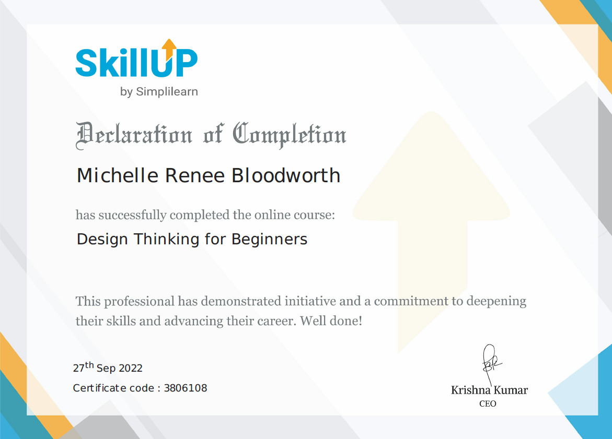

# Table of Contents

- [My Certifications](#my-certifications)
- [Screenshots](#screenshots)
- [Acknowledgments](#acknowledgments)

## My Certifications

These are my current certifications:

- AI Prompt Engineering
- Git and GitHub
- Design Thinking
- HTML Email Development
- Advanced Email Marketing

### Screenshots

- [Verify Credential](https://www.udemy.com/certificate/UC-57c172f4-db56-4937-a9d7-e70f8e3a73cb/)
- Certificate ID #: UC-57c172f4-db56-4937-a9d7-e70f8e3a73cb
- Reference No. 0004
- Course Summary: Comprehensive training in Generative AI and prompt engineering, covering AI fundamentals, large language models, advanced prompting techniques, and practical applications across modern AI tools. Explored AI-powered workflow automation, application development, data analysis, content generation, custom GPTs, voice AI agents, and organizational AI adoption strategies.
- Course Link:[AI Prompt Engineering](https://www.udemy.com/course/generative-ai-and-prompt-engineering)

- [Verify Credential](https://www.udemy.com/certificate/UC-6d43caf5-24f3-4e73-a268-4b5af4a4c3b2/)
- Certificate ID #: UC-6d43caf5-24f3-4e73-a268-4b5af4a4c3b2
- Reference No. 0004
- Course Summary: Comprehensive training in Git and GitHub, covering version control concepts, repository management, branching, merging, and conflict resolution. Explored advanced Git workflows including rebasing, commit history management, stashing, recovery techniques, version tagging, and Git internals, alongside remote repositories, collaborative development workflows, pull requests, and open-source contributions.
- Course Link: [Git and gitHub Bootcamp](https://www.udemy.com/course/git-and-github-bootcamp/)

- [Verify Credential]( https://www.simplilearn.com/skillup-certificate-landing?token=eyJjb3Vyc2VfaWQiOiIxNzgwIiwiY2VydGlmaWNhdGVfdXJsIjoiaHR0cHM6XC9cL2NlcnRpZmljYXRlcy5zaW1wbGljZG4ubmV0XC9zaGFyZVwvdGh1bWJfMzgwNjEwOF8xNjY0MjIyNDA3LnBuZyIsInVzZXJuYW1lIjoiTWljaGVsbGUgUmVuZWUgQmxvb2R3b3J0aCJ9&utm_source=shared-certificate&utm_medium=lms&utm_campaign=shared-certificate-promotion&referrer=https%3A%2F%2Flms.simplilearn.com%2Fcourses%2F4299%2FDesign-Thinking-for-Beginners%2Fcertificate%2Fdownload-skillup&%24web_only=true&_branch_match_id=970406155640884889&_branch_referrer=H4sIAAAAAAAAA8soKSkottLXL87MLcjJ1EssKNDLyczL1k%2FVrwo190kMTTRzKUkCANsQARMlAAAA)
- Certificate ID #: 3806108
- Course Summary: Foundational training in Design Thinking, exploring human-centered problem-solving, empathy mapping, and the principles behind innovative solution development. Covered the five phases and four pillars of Design Thinking, along with integrating Agile methodologies to support iterative development, collaboration, and continuous improvement.
- Course Link: [Design Thinking](https://www.simplilearn.com/learn-design-thinking-basics-free-course-skillup) 

- [Verify Credential](https://www.udemy.com/certificate/UC-164c8e46-a21f-47bd-86c2-4782a13e0a82/)
- Certificate ID#: UC-164c8e46-a21f-47bd-86c2-4782a13e0a82
- Reference No. 0004
- Course Summary: Specialized training in responsive HTML email development, covering mobile-friendly layouts, dark mode compatibility, and cross-client rendering. Explored advanced email development techniques including CSS media queries, Outlook-specific MSO conditional statements, bulletproof buttons, background images, responsive columns, and email testing across 80+ clients.
- Course Link: [HTML Email Development](https://www.udemy.com/course/html-email/)

- [Verify Credential](https://www.simplilearn.com/skillup-certificate-landing?token=eyJjb3Vyc2VfaWQiOiI2MDAiLCJjZXJ0aWZpY2F0ZV91cmwiOiJodHRwczpcL1wvY2VydGlmaWNhdGVzLnNpbXBsaWNkbi5uZXRcL3NoYXJlXC90aHVtYl80NTQxMjU2XzE2OTU4Mzc2NjAucG5nIiwidXNlcm5hbWUiOiJNaWNoZWxsZSBSZW5lZSBCbG9vZHdvcnRoIn0%3D&utm_source=shared-certificate&utm_medium=lms&utm_campaign=shared-certificate-promotion&referrer=https%3A%2F%2Flms.simplilearn.com%2Fcourses%2F2515%2FAdvanced-Email-Marketing%2Fcertificate%2Fdownload-skillup&%24web_only=true&_branch_match_id=940039034441098149&_branch_referrer=H4sIAAAAAAAAA8soKSkottLXL87MLcjJ1EssKNDLyczL1k%2FVLzQ0jjAKdyoockkCAI3yetUlAAAA)
- Certificate ID#: 4541256
- Course Summary: Comprehensive training in email marketing strategy, covering audience development, subscriber acquisition, list-building techniques, and campaign planning. Explored persuasive copywriting, subject line optimization, email automation, landing page development, campaign performance metrics, and email marketing regulations to support effective audience engagement and business growth.
- Course Link: [Email Marketing](https://www.simplilearn.com/learn-email-marketing-free-course-skillup) 

- Website - [michellerenee.dev](https://michellerenee.dev)
- CodePen - [@slimbloodworth](https://codepen.io/slimbloodworth)
- LinkedIn - [Michelle Renee Bloodworth](https://www.linkedin.com/in/michelle-renee-99b455187/)
- GitHub - [@slimbloodworth](https://github.com/SlimBloodworth)

## Acknowledgments

Simplilearn and Udemy have been very wonderful resources for education and certifications, and a great way to skillup.
